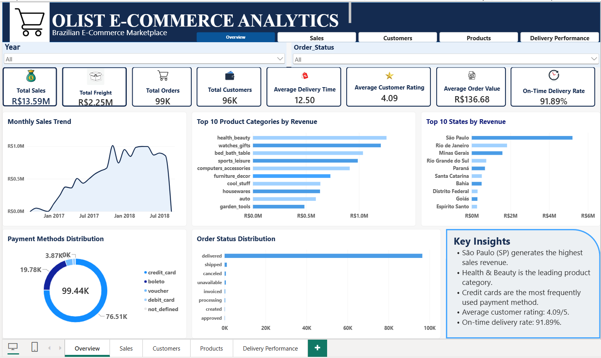
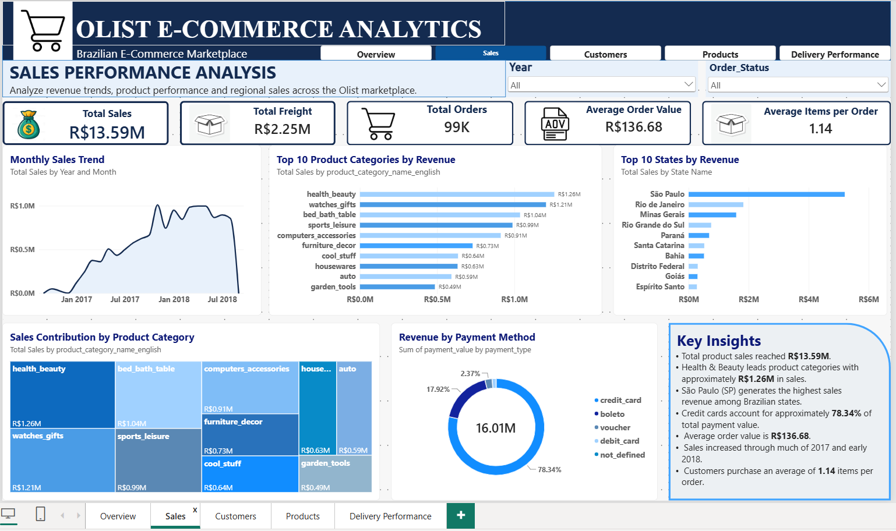
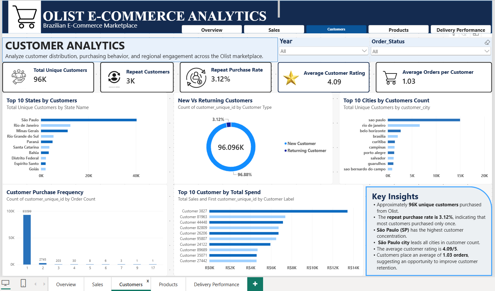
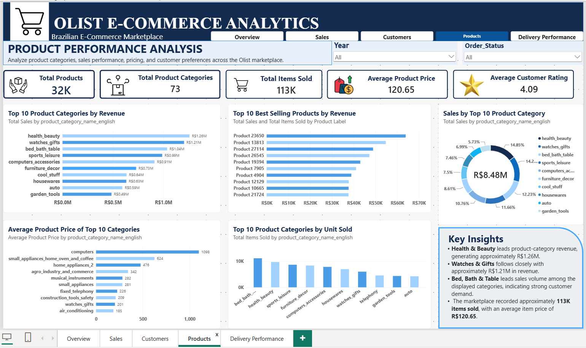
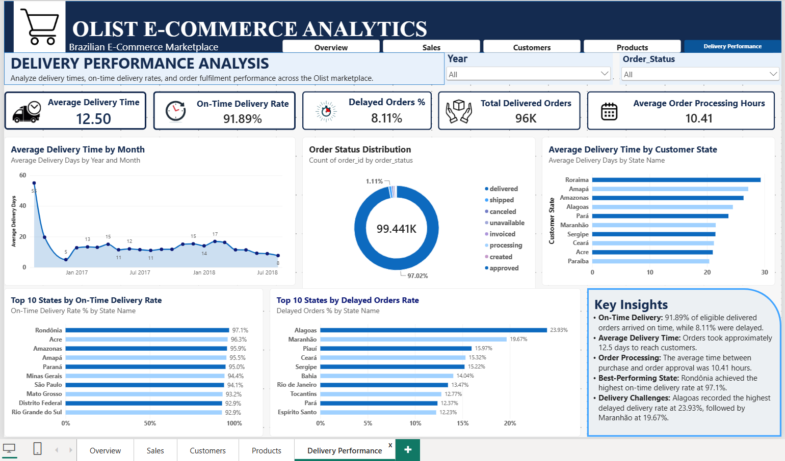
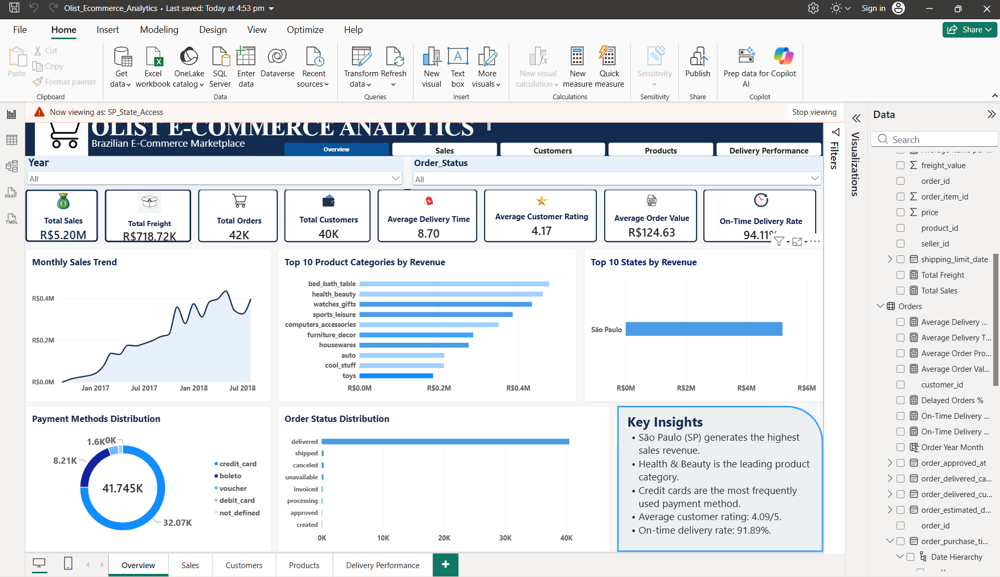
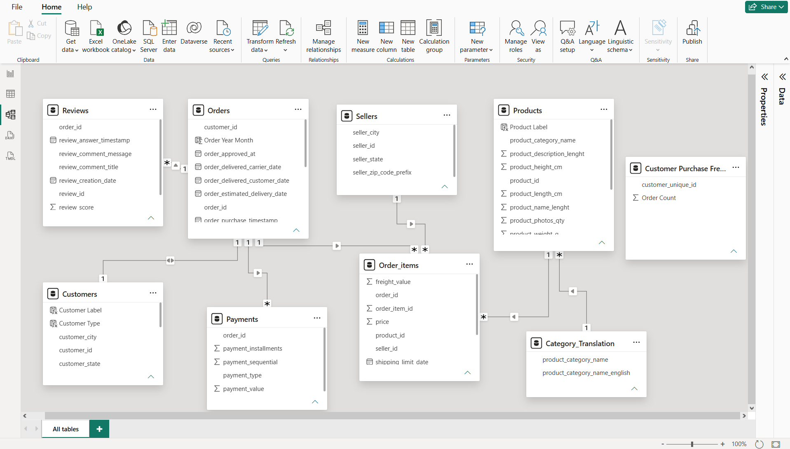

# Olist E-Commerce Analytics | MySQL & Power BI

## Project Overview

An end-to-end data analytics project using the Brazilian Olist e-commerce dataset. This project combines MySQL-based data analysis with an interactive, five-page Power BI dashboard to explore marketplace sales, customer behavior, product performance, and delivery efficiency.

## Tools & Technologies

- **MySQL:** SQL queries and data analysis
- **Power BI:** Data modeling, DAX measures, and interactive visualizations
- **Power Query:** Data transformation and cleaning
- **GitHub:** Project documentation and version control

## Dashboard Pages

1. **Overview:** Marketplace KPIs, revenue trends, orders, customer metrics, and business insights.
2. **Sales:** Sales performance, revenue trends, and geographical analysis.
3. **Customers:** Customer distribution, purchasing patterns, and customer insights.
4. **Products:** Product categories, revenue contribution, best-selling products, and customer ratings.
5. **Delivery Performance:** Delivery times, order status, on-time delivery rates, and state-level performance.

## Dashboard Screenshots

### 1. Overview


### 2. Sales Analysis


### 3. Customer Analysis


### 4. Product Performance


### 5. Delivery Performance


## Key Business Insights

- Total marketplace sales are approximately **R$13.59 million**.
- Approximately **99,000 orders** were recorded.
- The overall **on-time delivery rate is 91.89%**.
- Average delivery time is approximately **12.5 days**.
- The average customer rating is approximately **4.09 out of 5**.
- **Alagoas** has the highest delayed delivery rate among the states shown, at approximately **23.93%**.

## Project Files

- `Olist_Analysis.sql` — SQL analysis script
- `PowerBI/Olist_Ecommerce_Analytics.pbix` — Interactive Power BI report
- `01_Overview.png` to `05_Delivery_Performance.png` — Dashboard screenshots

## Project Objective

To transform Brazilian e-commerce transactional data into actionable business insights, identify sales opportunities, understand customer and product performance, and highlight delivery inefficiencies using SQL and business intelligence tools.

## Dataset

Brazilian E-Commerce Public Dataset by Olist, available on Kaggle.

## Row-Level Security (RLS)

### Overview

Implemented state-based Row-Level Security (RLS) in Power BI Desktop to restrict access to customer and transaction data based on geographical location.

### Security Configuration

| Property | Configuration |
|---|---|
| Security Role | `SP_State_Access` |
| Table | `Customers` |
| Column | `customer_state` |
| Filter Condition | Equals `SP` |
| Security Type | Static Row-Level Security |
| Testing Method | Power BI Desktop — View as Role |

### DAX Security Filter

```dax
[customer_state] = "SP"
```

This security rule restricts the role to customers located in São Paulo (SP), Brazil.

### RLS Testing & Validation

The security role was tested using Power BI Desktop's **View as** functionality.

| KPI | Full Dataset | São Paulo RLS |
|---|---:|---:|
| Total Sales | R$13.59M | R$5.20M |
| Total Orders | 99K | 42K |
| Total Customers | 96K | 40K |
| Average Customer Rating | 4.09 | 4.17 |
| On-Time Delivery Rate | 91.89% | 94.11% |

### Validation Results

- Successfully activated the `SP_State_Access` security role.
- Verified that dashboard KPIs changed after applying RLS.
- Confirmed that the revenue-by-state visual displayed only São Paulo.
- Verified that customer-based restrictions propagated through related transaction tables.

### RLS Testing Screenshot



**Note:** RLS was configured and tested locally in Power BI Desktop. Deployment and user-role assignments in Power BI Service have not yet been completed.

## Data Model & Relationships

The Olist E-Commerce Analytics Power BI report uses a relational data model connecting customer, order, product, seller, payment, review, and product-category information.

### Table Relationships

| Primary Table | Related Table | Relationship |
|---|---|---|
| Customers | Orders | One-to-One (1:1) |
| Orders | Order_items | One-to-Many (1:*) |
| Products | Order_items | One-to-Many (1:*) |
| Sellers | Order_items | One-to-Many (1:*) |
| Orders | Payments | One-to-Many (1:*) |
| Category_Translation | Products | One-to-Many (1:*) |
| Orders | Reviews | One-to-Many (1:*) |

All seven relationships are active.

### Model Design

- Orders connects customer, transaction, payment, and review information.
- Order_items provides item-level transaction details, including product, seller, price, and freight.
- Products and Category_Translation support product-category analysis.
- Sellers supports seller-related analysis.
- Customers supports customer segmentation and geographic analysis.
- Customer Purchase Frequency is an additional summary table used for purchasing-behavior analysis.

### Benefits

- Supports sales and revenue analysis across products and categories.
- Enables customer purchasing-behavior analysis.
- Supports payment, review, and delivery-performance reporting.
- Provides a structured foundation for Power BI visuals and DAX calculations.

### Data Model Diagram



## 📊 DAX Measures Documentation

This project uses **DAX (Data Analysis Expressions)** in Microsoft Power BI to calculate key performance indicators across sales, customers, products, and delivery performance.

### 1. Sales & Revenue Measures

**Total Sales**

Calculates total product sales revenue.

```dax
Total Sales =
SUM('Order_items'[price])
```

**Total Freight**

Calculates the total shipping/freight value.

```dax
Total Freight =
SUM('Order_items'[freight_value])
```

**Average Order Value**

Calculates average sales revenue per order.

```dax
Average Order Value =
DIVIDE([Total Sales], [Total Orders], 0)
```

**Average Items per Order**

Calculates the average number of purchased items per distinct order.

```dax
Average Items per Order =
DIVIDE(
    COUNTROWS(Order_items),
    DISTINCTCOUNT(Order_items[order_id]),
    0
)
```

### 2. Customer Analytics Measures

**Total Customers / Total Unique Customers**

Counts distinct customers using their unique customer identifiers.

```dax
Total Customers =
DISTINCTCOUNT('Customers'[customer_unique_id])
```

```dax
Total Unique Customers =
DISTINCTCOUNT(Customers[customer_unique_id])
```

These two measures use the same distinct-customer calculation.

Additional customer KPIs displayed in the dashboard:

- Repeat Customers: approximately 3K
- Repeat Purchase Rate: 3.12%
- Average Orders per Customer: 1.03

Their full DAX definitions were not visible in the provided screenshots.

### 3. Product Performance Measures

**Total Products**

Calculates the number of distinct products.

```dax
Total Products =
DISTINCTCOUNT(Products[product_id])
```

**Total Product Categories**

Calculates the number of distinct product categories.

```dax
Total Product Categories =
DISTINCTCOUNT(Products[product_category_name])
```

**Total Items Sold**

Counts the rows in the order items table.

```dax
Total Items Sold =
COUNTROWS(Order_items)
```

**Average Product Price**

Calculates the average price of purchased items.

```dax
Average Product Price =
AVERAGE('Order_items'[price])
```

### 4. Customer Satisfaction Measures

**Average Customer Rating**

Calculates the average review score.

```dax
Average Customer Rating =
AVERAGE('Reviews'[review_score])
```

Dashboard result: **4.09 / 5**

### 5. Delivery Performance Measures

**Average Delivery Time**

Calculates the average number of days between purchase and customer delivery for delivered orders with valid timestamps.

```dax
Average Delivery Time =
AVERAGEX(
    FILTER(
        'Orders',
        'Orders'[order_status] = "delivered"
            && NOT ISBLANK('Orders'[order_purchase_timestamp])
            && NOT ISBLANK('Orders'[order_delivered_customer_date])
    ),
    DATEDIFF(
        'Orders'[order_purchase_timestamp],
        'Orders'[order_delivered_customer_date],
        DAY
    )
)
```

**Average Delivery Days**

Calculates the average delivery duration for orders with available purchase and delivery dates, without an explicit delivered-status filter.

```dax
Average Delivery Days =
AVERAGEX(
    FILTER(
        Orders,
        NOT ISBLANK(Orders[order_delivered_customer_date])
            && NOT ISBLANK(Orders[order_purchase_timestamp])
    ),
    DATEDIFF(
        Orders[order_purchase_timestamp],
        Orders[order_delivered_customer_date],
        DAY
    )
)
```

**Average Order Processing Hours**

Calculates the average number of hours between purchase and order approval.

```dax
Average Order Processing Hours =
AVERAGEX(
    FILTER(
        Orders,
        NOT ISBLANK(Orders[order_purchase_timestamp])
            && NOT ISBLANK(Orders[order_approved_at])
    ),
    DATEDIFF(
        Orders[order_purchase_timestamp],
        Orders[order_approved_at],
        HOUR
    )
)
```

**On-Time Delivery Rate %**

Calculates the percentage of eligible delivered orders that arrived on or before their estimated delivery date.

```dax
On-Time Delivery Rate % =
VAR DeliveredOrders =
    FILTER(
        Orders,
        Orders[order_status] = "delivered"
            && NOT ISBLANK(Orders[order_delivered_customer_date])
            && NOT ISBLANK(Orders[order_estimated_delivery_date])
    )
VAR OnTimeOrders =
    FILTER(
        DeliveredOrders,
        INT(Orders[order_delivered_customer_date])
            <= INT(Orders[order_estimated_delivery_date])
    )
RETURN
    DIVIDE(
        COUNTROWS(OnTimeOrders),
        COUNTROWS(DeliveredOrders),
        0
    )
```

**Delayed Orders %**

Calculates the percentage of eligible delivered orders that arrived after their estimated delivery date.

```dax
Delayed Orders % =
VAR DeliveredOrders =
    FILTER(
        Orders,
        Orders[order_status] = "delivered"
            && NOT ISBLANK(Orders[order_delivered_customer_date])
            && NOT ISBLANK(Orders[order_estimated_delivery_date])
    )
VAR DelayedOrders =
    FILTER(
        DeliveredOrders,
        Orders[order_delivered_customer_date]
            > Orders[order_estimated_delivery_date]
    )
RETURN
    DIVIDE(
        COUNTROWS(DelayedOrders),
        COUNTROWS(DeliveredOrders),
        0
    )
```

**On-Time Delivery Rate**

An additional measure with this name appears in the project screenshots. Its calculation uses the same on-time order logic as `On-Time Delivery Rate %`, with a date comparison that includes the time component.

The screenshot shows it formatted as a whole number rather than a percentage.

### 6. Dashboard KPI Summary

| KPI | Dashboard Value |
|---|---|
| Total Sales | R$13.59M |
| Total Freight | R$2.25M |
| Total Orders | 99K |
| Unique Customers | 96K |
| Average Order Value | R$136.68 |
| Average Items per Order | 1.14 |
| Total Products | 32K |
| Product Categories | 73 |
| Total Items Sold | 113K |
| Average Customer Rating | 4.09 / 5 |
| Average Delivery Time | 12.50 days |
| On-Time Delivery Rate | 91.89% |
| Delayed Orders | 8.11% |
| Average Order Processing Hours | 10.41 |

### 7. DAX Functions Used

| Function | Purpose |
|---|---|
| `SUM()` | Calculates total sales and freight |
| `DISTINCTCOUNT()` | Counts unique customers, products and categories |
| `COUNTROWS()` | Counts rows in a table |
| `AVERAGE()` | Calculates average prices and ratings |
| `AVERAGEX()` | Evaluates average durations row by row |
| `FILTER()` | Applies conditions to order records |
| `DATEDIFF()` | Calculates time differences |
| `DIVIDE()` | Performs division with an alternate result |
| `VAR` | Stores intermediate calculation results |
| `ISBLANK()` | Identifies missing values |
| `INT()` | Removes the time portion of date-time values for comparison |

### 8. Business Applications

These DAX measures support:

- **Sales analysis:** Revenue, freight, average order value and purchasing patterns.
- **Customer analysis:** Unique customer counts, repeat purchases and customer satisfaction.
- **Product analysis:** Product assortment, sales volume and pricing.
- **Delivery analysis:** Delivery speed, processing time, on-time performance and delays.

Together, these measures power the five-page interactive Power BI dashboard and support data-driven analysis of the Brazilian e-commerce marketplace.

## Author

**Ditya Gupta**

Data Analytics | SQL | Power BI | Excel | Python
